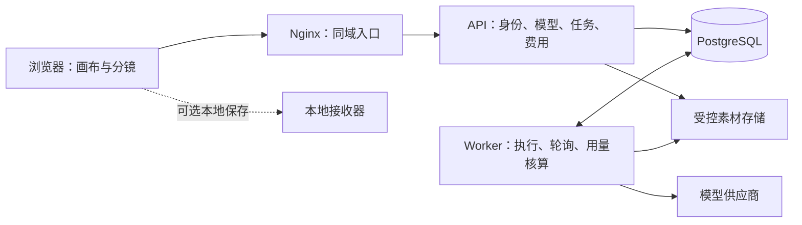

# Elren Studio 前后端分离与模型用量计费方案

> 版本：v0.1。状态：设计基线，已开始实施。
> 当前已实现的范围、验证方式和仍未开放的能力见 [后端运行说明](../../server/README.md)。本文保留完整目标，不作为功能完成清单。

## 1. 目标与范围

保留现有画布、分镜、文字、图片和视频编辑体验，增加独立后端，提供登录、用户管理、模型调用、用量计价以及用户和项目费用统计。

这里的“计费”指形成可核对的费用记录。第一版不提供充值、在线支付、钱包余额、欠费催收、支付订单和退款流程，也不预扣资金。费用记录不表示已经收款。

### 1.1 已确定的方向

| 项目 | 方案 |
| --- | --- |
| 计价依据 | 按实际模型及其计量规则计算，支持 Token、图片张数、百万像素、视频秒数等 |
| 平台定价 | 支持“官方参考单价 × 加价系数”，发布后形成独立的平台价格版本 |
| 成本核算 | 单独记录实际接入渠道的供应商成本，不把官方参考价当作采购成本 |
| 用户展示 | 优先展示金额，提供任务明细和用户、项目汇总 |
| 积分 | 第一版不引入；以后可以作为金额的换算展示层 |
| 权威数据 | 身份、价格、用量及费用均由后端确认 |
| 改造方式 | 逐步抽取请求和存储边界，保留编辑器主体 |

### 1.2 建议采用的第一版默认规则

- 单组织部署，角色为管理员和普通用户；每个项目归属一个用户，暂不加入团队共享和复杂租户体系。
- 管理员创建账号，用户登录后修改初始密码；公开注册、短信、邮件找回和企业单点登录后续按需接入。
- 用户费用以人民币展示，供应商成本保留原币种；汇率由管理员维护并发布版本，不自动抓取实时汇率。
- 加价比例按模型配置，不设置一个未经确认的全局商业比例。示例数字不作为实际售价。
- 第一版只上线已有明确计量规则的模型。未支持的模型在平台模式中标记为暂不可用。
- 默认只向用户计入已交付结果对应的费用；平台内部失败和重试成本单独记录。具体规则见第 6 节。
- 第一版只统计费用，不做费用预算拦截；仍设置账号、模型和渠道的请求频率及并发限制。

## 2. 现状与改造入口

以下内容已通过当前源码检查确认；本次没有运行浏览器或供应商请求。

| 现状 | 代码入口 | 改造方向 |
| --- | --- | --- |
| React + Vite，单文件构建 | `package.json`、`vite.config.js` | 前端继续独立构建和部署；是否拆包另行处理 |
| 主要逻辑集中在约 3.85 万行文件中 | `src/App.jsx` | 先抽取请求、任务和存储服务，避免一次性重写编辑器 |
| Provider 和全局 Key 存在浏览器 | `elren_providers`、`elren_global_key`、`getApiCredentials` | 平台凭据转为后端管理 |
| 浏览器直接发送文字请求 | `sendChatMessage` | 统一提交后端任务 |
| 图片、视频及分镜生成入口 | `startGeneration` | 保留交互和参数收集，执行交给后端 |
| 浏览器维护队列和轮询 | `batchQueue`、`pollImageTask`、`pollSoraJob`、`pollVeoJob`、`pollAsyncTask` | 后端持久化执行和查询状态，前端查询自身后端 |
| 模型 ID 支持同名条目 | `_uid`、`getApiConfigByKey` | 使用后端稳定 ID，区分产品模型、渠道和上游模型标识 |
| 模型模板包含请求和解析规则 | `requestTemplate`、`asyncConfig`、`docs/models/model-template-readme.md` | 迁移为管理员控制的渠道适配配置 |
| 历史、聊天、图片及自动保存留在本机 | `localStorage`、`LocalImageManager`、`openAutoSaveDb` | 先做用户和项目隔离；云端编辑器同步后续增加 |
| 现有 Python 服务处理文件和代理 | `localserver/elren-server-full.py` | 保留为可选本地工具；新增独立业务后端 |
| 当前部署为静态站点加本地接收器 | `docker-compose.yml`、`docker/nginx/default.conf` | 增加 API、Worker、数据库和受控素材存储 |

已有调用链适合复用模型能力定义和参数映射，但不能只替换聊天请求。小说分析、角色提取、分镜拆解、图片编辑、批量生成、模型测试等产生供应商用量的入口，都要纳入迁移清单。

## 3. 目标架构



### 3.1 建议技术组合

| 层次 | 建议 | 原因 |
| --- | --- | --- |
| 前端 | 继续 React + Vite | 复用现有编辑器和组件 |
| API | Python + FastAPI，独立 `server/` 目录 | 与现有 Python 工具环境接近，集中处理身份、校验和业务接口 |
| 数据库 | PostgreSQL，SQLAlchemy + Alembic | 持久化任务、价格版本、用量及费用，支持事务和迁移 |
| 后台执行 | 独立 Python Worker，第一版以数据库任务表调度 | 避免任务生命周期依赖浏览器或 API 请求进程 |
| 素材 | 第一版使用受控持久化目录，通过存储接口封装 | API 与 Worker 共享卷；后续可替换为对象存储 |
| 部署 | Docker Compose，Nginx 同域转发 `/api/` | 延续当前部署方式，减少跨域会话配置 |

任务表领取可以使用短事务和 `FOR UPDATE SKIP LOCKED`；PostgreSQL 官方文档将多消费者队列表列为适用场景。这只解决领取时的锁竞争，任务恢复和外部调用去重仍需自行设计。[PostgreSQL SELECT 文档](https://www.postgresql.org/docs/16/sql-select.html)

任务需要持久化状态、租约和恢复逻辑，不以 FastAPI 的进程内 `BackgroundTasks` 承担可靠调度。API 和 Worker 共用业务代码、独立运行；需要扩容时可再引入专门的消息队列。[FastAPI 后台任务说明](https://fastapi.tiangolo.com/tutorial/background-tasks/)

### 3.2 模块边界

建议目录：

```text
server/app/
  auth/          登录、会话、用户管理
  projects/      项目归属和统计标识
  models/        平台模型、渠道和参数定义
  providers/     供应商适配、提交、查询和用量解析
  pricing/       价格版本、估算、汇率和费用计算
  tasks/         任务状态、幂等、取消和执行恢复
  metering/      用量证据、成本、用户费用和调整记录
  assets/        上传、输出保存和访问控制
  admin/         管理接口和操作审计
  worker/        领取、执行、轮询和核对调度

src/services/
  apiClient.js
  authService.js
  modelService.js
  taskService.js
  usageService.js
  projectStorage.js
  assetService.js
```

第一版是模块化单体服务，不拆微服务。前端调用这些服务时使用统一任务协议，逐步替换 `App.jsx` 中的直接请求。

## 4. 用户、权限和项目归属

### 4.1 角色能力

| 能力 | 普通用户 | 管理员 |
| --- | --- | --- |
| 使用已开放模型、查看公开单价 | 是 | 是 |
| 查看本人任务、素材和费用 | 是 | 是 |
| 查看其他用户费用和运行状态 | 否 | 是，记录管理操作 |
| 查看供应商成本和平台差额 | 否 | 是 |
| 创建、停用账号和重置密码 | 否 | 是 |
| 配置渠道、模型和发布价格 | 否 | 是 |
| 调整已记费用 | 否 | 是，必须填写原因并生成调整记录 |

管理员统计视图不默认展示用户提示词、聊天内容或输入素材。任务内容访问与费用统计区分；排障需要访问内容时应显式操作并留审计记录。

会话建议使用服务端随机会话 ID，数据库只保存其哈希，浏览器使用 `HttpOnly`、`Secure`、`SameSite=Lax` Cookie。同域部署配合变更请求的 CSRF 校验和 Origin 校验。登录后轮换会话；退出、改密和停用账号撤销相关会话。具体过期时间作为配置管理。[OWASP 会话管理](https://cheatsheetseries.owasp.org/cheatsheets/Session_Management_Cheat_Sheet.html)、[CSRF 防护](https://cheatsheetseries.owasp.org/cheatsheets/Cross-Site_Request_Forgery_Prevention_Cheat_Sheet.html)

密码使用成熟库提供的 Argon2id 哈希；登录失败限速。初始管理员通过部署初始化命令创建，不提供默认密码。管理员重置产生一次性凭据，首次使用后强制改密。

所有项目、任务、费用和素材接口都根据会话校验归属；服务端不接受客户端指定自己的 `user_id`。账号停用后拒绝新任务及未发出的排队任务，已提交上游的任务继续核对结果和成本。[OWASP 授权指南](https://cheatsheetseries.owasp.org/cheatsheets/Authorization_Cheat_Sheet.html)

### 4.2 项目统计先于云端编辑器

第一版后端只需保存项目 ID、所有者、名称和归档状态，画布完整内容仍可本地保存。进入画布时创建或关联后端项目 ID，此后的任务自动携带该 ID；后端校验其所有者。

每个用户有一个默认项目承接独立聊天及未命名画布。节点、镜头、聊天会话 ID 是任务的定位标签，不承担权限校验。项目重命名或归档不影响历史费用归属；本地删除节点也不删除费用记录。

## 5. 模型定价和金额规则

### 5.1 三种价格含义

| 名称 | 用途 | 示例来源 |
| --- | --- | --- |
| 官方参考价 | 制定平台售价时的依据 | 官方价格页面、记录时间和人工录入值 |
| 渠道成本价 | 核算实际调用成本 | 实际供应商合同或渠道价目表 |
| 平台售价 | 计算用户费用 | 官方参考价乘加价系数后发布的价格 |

官方参考价和渠道成本价不相互替代。某渠道没有对应的官方价时，可以人工配置平台售价，并明确标为平台定价，避免声称按官方价透传。

管理员维护参考价和成本价，预览新平台售价后发布。单价、汇率、单位换算及加价规则变化均生成新版本；不自动跟随网页更新，不修改已发布版本。

### 5.2 计量维度

| 模型能力 | 可使用的计量维度 | 实施要求 |
| --- | --- | --- |
| 文字生成和分析 | 非缓存输入、输出、缓存读取、缓存写入等 Token | 依渠道定义拆分，防止缓存子项和输入总量重复相加 |
| 图片生成和编辑 | 图片张数、输入/输出百万像素、图片 Token、文字 Token | 按该模型真实规则选用，可以包含多个计价组件 |
| 视频生成 | 秒数、分辨率、有无音频，或供应商规定的 Token | 保存实际规格和时长，不用浏览器等待时间计价 |
| 额外模型工具 | 搜索次数等独立计费项 | 适配和价格明确后开放；未支持的付费工具在参数校验时禁止 |
| 本地执行 | 平台另行定义的次数或资源计量 | 第一版不纳入平台模型计费 |

例如 FLUX 部分模型按百万像素计价，Veo 按视频秒数和规格计价，文字模型还可能对缓存使用不同费率，因此计费引擎要支持多个组件。[FLUX 官方定价](https://docs.bfl.ai/quick_start/pricing)、[Google 模型定价](https://ai.google.dev/gemini-api/docs/pricing)

计费组件应包含 `meter`、`unit`、`unit_size`、`unit_price`、`currency`、适用规格和分段规则。按百万 Token 报价时，`unit_size = 1000000`；按张报价时为 `1`。百万像素的分档和向上取整等规则按模型配置，不能简单假定都线性计价。

`reasoning_tokens` 等字段可能已经包含于输出 Token 总量。适配器保存原始返回，并输出不重复的计费项；仅凭字段名相同不能认为两个渠道含义相同。用量来源以供应商响应、任务查询或后续账单为依据，前端估计只用于预估。

### 5.3 计算与快照

对线性组件，基本公式为：

```text
组件金额 = 实际用量 / 单价单位大小 × 对应单价
原币种金额 = 所有组件金额之和
展示币种金额 = 原币种金额 × 锁定的汇率

平台发布单价 = 官方参考单价 × (1 + 加价比例)
用户任务费用 = Σ(符合用户计费规则的用量 / 对应单位大小 × 平台发布单价)
供应商任务成本 = Σ(各调用尝试的真实用量 / 对应单位大小 × 渠道成本价)
```

平台售价在创建任务时锁定；渠道成本版本在每次实际发出调用前锁定，记录调用时间。任务保留快照，后续调价不影响其用户售价。供应商账单带来的成本修正单独追加，不连带重算用户售价。

快照至少保存模型、渠道、计量组件、规格条件、参考价依据、加价比例、单价、原币种、汇率方向及版本、计算规则版本。对用户只返回平台售价和必要的计费说明。

仅用于说明的例子：参考金额为 ¥0.20，加价比例为 20%，用户金额为 ¥0.24；如果渠道成本为 ¥0.15，则差额为 ¥0.09。差额尚未扣除存储、服务器等运营支出，不作为净利润展示。20% 不是本方案设定的默认售价。

金额使用 Python `Decimal` 和 PostgreSQL `NUMERIC`，建议金额字段精度 `NUMERIC(24,12)`；API 返回十进制字符串。按组件计算后汇总，展示时才按固定规则四舍五入，不能每次请求先舍入到分再累计。小额费用显示更多小数或“< ¥0.01”，不直接显示为免费；明细和导出保留可核对精度。

### 5.4 预估和报价有效性

创建任务前调用估算接口，返回单价、估算类型、金额或区间及短期有效的 `quote_id`。报价绑定用户、项目、模型、输入/素材版本、计价参数和平台价格版本。未改变输入时，报价有效期内沿用该版本；修改规格、输出上限或素材后重新估算。

- 按固定张数或秒数计价的请求，在计价条件确定时可给出较准确估算。
- 文字请求根据输入和输出上限估计；无法可靠估计图片 Token、推理量或上游分段行为时，明确显示估算或无法估算。
- 预估不等于费用上限承诺。报价接口不得把缺少用量信息解释为零费用。
- 后端校验报价与实际请求一致，校验通过后将快照复制到任务。报价过期返回 `QUOTE_EXPIRED`，前端更新估算。

## 6. 任务执行与费用形成

### 6.1 区分三种记录

- **业务任务 task**：用户发起一次文字、图片、视频或批量操作；费用在此汇总。
- **调用尝试 attempt**：向供应商实际提交的一次执行；内部重试和换 Key 也要独立记录。
- **用量与费用**：用量是供应商计量证据；成本和用户费用分别根据各自规则形成。

批量任务有稳定的子项 ID。一个上游原生多图请求可以对应多个输出；拆成多次请求时有多个 attempt。整个上游响应的总用量不能复制到每张图片上重复计费。无法准确分配到单张时，以该批次作为费用单位。

拆分执行时用父任务聚合子任务，父任务只展示合计、不重复产生费用分录。原生多图可用一个任务关联多个输出。一个画布操作触发多个真实业务步骤时，各步骤分别记录，再按项目、节点或批次聚合。

### 6.2 正常流程

1. 前端获取模型能力和公开价格，上传必要素材并请求费用估算。
2. 前端带 `Idempotency-Key`、`quote_id` 和业务参数提交任务。
3. API 校验登录、项目归属、模型权限、素材归属和参数，在一个事务中写入任务及价格快照。
4. Worker 领取任务，写入调用尝试及渠道成本快照，然后调用供应商。
5. 异步模型保存上游任务 ID，并由 Worker 持续查询；前端仅查询平台任务。
6. Worker 保存结果、原始用量和标准计量项，再按锁定规则形成费用明细。
7. 前端展示结果和实际费用；无法完成核算时保留结果并显示“费用待核算”。

提交任务不需要钱包、不预占资金。后端持久化的任务与费用状态分别维护，刷新或关闭浏览器不会决定任务成败或计费结果。

### 6.3 独立状态

| 维度 | 建议状态 |
| --- | --- |
| 任务执行 | `queued`、`submitting`、`running`、`reconciling`、`succeeded`、`partially_succeeded`、`failed`、`canceled` |
| 用户计费 | `pending`、`recorded`、`not_billable` |
| 供应商成本 | `pending`、`calculated`、`confirmed`、`not_incurred` |

`calculated` 表示按渠道价目表计算，`confirmed` 表示已有供应商账单或直接金额依据。结果已生成但下载失败时，任务保持核对/交付处理中，不能因为下载失败直接重新生成。

成本和用户费用可以独立完成：例如结果和平台计量已确认，但供应商成本尚待账单。页面分别展示待核算项，不将未知成本或未知用户金额填为零。

### 6.4 边界处理建议

| 情况 | 用户费用 | 供应商成本和执行处理 |
| --- | --- | --- |
| 本地校验失败或排队中取消，尚未发送 | 不计费 | 记录未调用上游 |
| 已交付成功结果且用量明确 | 按锁定售价记账 | 按实际渠道记录成本 |
| 上游明确失败且未交付结果 | 默认不向用户计费 | 若上游产生费用，照实记入成本 |
| 文字中途失败或取消 | 第一版默认不对不完整结果计费 | 保留已发生用量；以后若支持部分交付计费，需单独发布规则 |
| 多图/分镜部分成功 | 按可确定的成功部分记账 | 所有实际尝试都计入成本；原生批次无法分摊的部分待核算 |
| 平台自动重试或换 Key | 不把内部重复尝试重复计给用户 | 每次可能收费的提交独立记录，失败成本由平台承担 |
| 用户主动再次生成 | 形成新任务，按当次售价计费 | 不与原任务合并去重 |
| 网络超时、上游是否接受未知 | 待核算，不立即判定免费或重新提交 | 先按上游 ID、幂等键或请求标识核对 |
| 有结果但无可靠用量 | 费用待核算 | 继续查询/对账；有契约依据的按张或按秒结果可据此计量 |
| 已发出的任务请求取消 | 先返回取消请求状态，不承诺立即取消成功 | 查询实际取消结果；完成在先则按交付规则处理 |

平台内部重试承担的成本会影响差额统计，需要单独汇总“重试成本”和“未向用户计费的成本”。明确失败不等于供应商免费。

### 6.5 幂等与执行恢复

- 同一用户相同 `Idempotency-Key` 和请求指纹返回同一任务；同键不同参数返回冲突，不创建第二次调用。认证和归属校验后优先查找已有任务，再对新任务校验报价有效期，避免响应丢失后因报价过期无法查回结果。
- 每次上游提交有稳定的 attempt ID 和幂等键；只有供应商明确支持时才依赖其幂等能力。
- 任务领取使用短事务、租约、心跳和执行代次；网络调用期间不长期持有数据库行锁。
- API 写入成功但响应丢失，可用原幂等键查回任务。队列以任务表为事实来源，避免“已建任务但忘记入队”。
- Worker 在上游接受请求后、保存 ID 前崩溃时，任务进入 `reconciling`。无上游去重/查询能力时暂停自动重发，由管理员核对；不能承诺外部调用绝对只执行一次。
- 上游轮询、回调和恢复可能重复到达。用量证据版本、原始费用分录和结果 ID 各有唯一约束；重复响应不重复入账。
- 后续轮询给出的累计用量覆盖“最新证据视图”，不作为新增增量反复累加。原始证据版本保留。
- 已入账金额更正时追加冲正/调整分录并关联原记录，不覆盖旧金额。成本和用户金额分别调整。

## 7. 数据结构建议

下面是逻辑表设计，字段在实施时转为数据库迁移；不要求一开始建立复杂的通用财务总账。

| 表 | 主要字段 | 关键约束 |
| --- | --- | --- |
| `users` | ID、登录名、密码哈希、角色、状态、需改密标记 | 登录名唯一；停用不删除历史归属 |
| `sessions` | 会话哈希、用户、过期时间、撤销时间 | 不保存明文会话令牌 |
| `projects` | ID、用户、名称、归档时间 | 服务端校验所有者；默认项目唯一 |
| `provider_channels` | 渠道 ID、协议、受控地址、凭据引用、并发配置、启停状态 | Key 通过部署密钥或加密配置保存，不返回浏览器 |
| `model_offerings` | 平台模型 ID、显示名、能力、渠道、上游模型 ID、参数及适配版本 | 同名模型也有不同稳定 ID；第一版一个 offering 绑定一个确定渠道 |
| `price_versions` | offering、类型、计价组件、币种、汇率、参考依据、加价规则、生效时间 | 类型区分成本价和平台售价；已发布版本不可原地修改 |
| `quotes` | 用户、项目、模型、输入指纹、售价快照、估算、有效期 | 服务端生成；任务提交时校验归属、期限和指纹 |
| `tasks` | 用户、项目、模型、父任务、幂等键、请求指纹、输入/参数、定位标签、结果清单、价格快照、执行/费用状态、取消请求时间、租约 | 用户与幂等键唯一；重试沿用已锁定的平台售价 |
| `task_attempts` | task、子项、序号、渠道、上游 ID、请求标识、成本快照、提交状态 | attempt ID 唯一；与账单核对关联 |
| `usage_records` | attempt、来源、证据版本、原始 usage、标准计量项、确认时间 | 对同一证据去重；区分未知与已知为零 |
| `charge_entries` | task、attempt/子项、账目类型、原币金额、展示币金额、计量与价格快照、原分录引用、原因 | 类型区分供应商成本和用户费用；原始分录唯一，调整追加 |
| `assets` | 用户、项目、task、存储键、大小、类型、哈希、状态 | 存储键由服务端生成，访问检查归属 |
| `audit_events` | 操作者、动作、目标、时间、修改摘要 | 用户管理、价格发布、成本查看和费用调整可追踪 |

成本原始分录以“attempt + 计费组件”标识，用户原始分录以“业务任务/输出组 + 计费组件”标识，分别设唯一约束。证据版本、对应分录和费用状态在同一数据库事务内更新；人工调整也带幂等键，追加的分录引用原分录和证据。汇总只加总分录及调整净额，不再次加总父任务的展示金额。

建议为任务和费用的 `(user_id, created_at)`、`(project_id, created_at)`、`(model_offering_id, created_at)` 建索引，为 Worker 的状态与下次处理时间建调度索引。上游 ID 按渠道限定唯一范围，不能假定不同供应商的 ID 全局唯一。

所有时间按 UTC 保存，统计接口明确时区及日期区间。任务时间和费用记账时间分别保留；按任务发生时间统计使用情况，迟到核算会更新该历史期间，并返回报表生成时间和待核算数量。已发布的历史报表快照如以后需要，应单独实现。

## 8. API 草案

统一前缀 `/api/v1`。金额为字符串，列表使用游标分页，错误返回稳定的 `code` 与可读 `message`。所有受保护接口执行会话和归属校验。

| 接口 | 作用 |
| --- | --- |
| `POST /auth/login`、`POST /auth/logout`、`GET /auth/me` | 登录、退出、当前用户 |
| `POST /auth/change-password` | 修改密码并撤销旧会话 |
| `GET/POST /projects`、`PATCH /projects/{id}` | 项目标识、名称与归档 |
| `GET /models` | 可用模型、能力、可选规格与平台公开单价 |
| `POST /pricing/estimate` | 校验输入并产生带版本的报价 |
| `POST /assets`、`GET /assets/{id}/content` | 上传输入和获取有权访问的素材 |
| `POST /tasks` | 幂等提交模型任务，返回 `202` 和任务 ID |
| `GET /tasks`、`GET /tasks/{id}` | 任务恢复、进度、结果和费用状态 |
| `POST /tasks/{id}/cancel` | 请求取消，返回真实取消进度 |
| `GET /usage/summary`、`GET /usage/records` | 本人按项目、模型、时间查询费用 |
| `GET/POST /admin/users`、`PATCH /admin/users/{id}` | 用户列表、创建、启停和角色管理 |
| `POST /admin/users/{id}/reset-password` | 生成一次性重置凭据并撤销会话 |
| `GET/POST /admin/channels`、`PATCH /admin/channels/{id}` | 渠道配置和凭据引用管理 |
| `GET/POST /admin/models`、`PATCH /admin/models/{id}` | 模型、适配版本、开放范围与参数管理 |
| `GET/POST /admin/price-versions`、`POST /admin/price-versions/{id}/publish` | 价格草稿、预览和发布 |
| `POST /admin/models/{id}/test` | 创建明确标识为管理员测试的任务，记录成本 |
| `GET /admin/usage/summary`、`GET /admin/usage/records` | 全站用量、成本、用户金额、差额及待核算统计 |
| `POST /admin/tasks/{id}/reconcile` | 根据证据重新核对，不等于重新生成 |
| `POST /admin/charge-adjustments`、`GET /admin/audit-events` | 追加费用调整、查询审计 |

`POST /tasks` 请求形态示例，ID 均为占位符：

```json
{
  "project_id": "project-id",
  "model_offering_id": "offering-id",
  "operation": "image.generate",
  "quote_id": "quote-id",
  "source": { "node_id": "node-id", "shot_id": "shot-id" },
  "input": {
    "prompt": "用户输入",
    "asset_ids": ["asset-id"],
    "parameters": { "resolution": "2K", "count": 2 }
  }
}
```

请求头携带 `Idempotency-Key`。普通用户请求不包含 Provider Key、任意 Base URL、价格、加价比例或自报的最终用量。文字任务的 `input` 使用消息数组，其他能力按后端公布的参数模式验证。

费用响应建议包含 `currency`、`amount`、`status`、`price_version_id`、计量明细。汇总返回 `recorded_amount`、`pending_count`、`not_billable_count`，不能把“待核算”与“免费”合并。管理接口另返回成本状态和差额；成本未齐时差额标记为不完整。

第一版采用前端定时查询平台任务；流式文字和 SSE 可在已有持久化任务协议上补充。传输断开不触发第二个任务。

## 9. 前端体验与素材处理

### 9.1 界面增量

- 登录后进入现有编辑器；头像菜单增加“使用明细”，管理员增加管理入口。
- 模型选择处展示平台模型名、规格和计价单位；普通用户不管理平台渠道 Key。
- 生成按钮附近显示预计费用或估算区间，不额外增加每次执行的确认弹窗。
- 结果卡片显示“本次费用”，未知时显示“费用待核算”；详细 Token、张数、秒数在展开明细中查看。
- 项目显示累计已记费用和待核算任务数；用户可以按项目、模型和时间筛选。
- 管理界面提供用户、渠道、模型、价格、费用和异常核对页面，复用现有视觉规范。

### 9.2 素材是后端执行的必要前提

浏览器的 `blob:`、IndexedDB 图片 ID 和用户电脑的 `localhost` 地址不能直接交给云端 Worker。平台生成前必须解析这些本地引用，上传实际文件，取得 `asset_id`。

后端检查文件类型、大小及归属，保存到受控目录。供应商需要公开下载地址时，生成短期有效且范围受限的访问链接；也可由适配器直接上传文件。普通请求不允许让后端任意抓取用户提供的地址。

输出尽量由 Worker 保存为平台资产，随后交付前端，避免供应商临时 URL 失效。签名地址、数据库凭据和 Key 不进入历史导出或普通日志。素材保留时长单独配置，第一版不向用户计入存储费。

部署后的本地接收器继续承担用户电脑上的保存需求。云端后端不能把自己的 `localhost` 当作用户电脑；接收器也不作为平台登录与计费接口暴露。

## 10. 迁移和兼容策略

### 10.1 先建立调用边界

用 `taskService` 接管文字、分析、图片、视频、分镜等任务提交与恢复；`modelService` 接管模型和价格读取；`projectStorage` 处理本地隔离；`assetService` 解析、上传和下载素材。

`startGeneration` 等现有入口初期保留参数收集、蒙版处理、节点状态及结果回填，将具体网络执行移到服务层。请求模板按协议逐个迁移成后端适配器，不把浏览器的整段配置原样变成一个任意代理接口。

### 10.2 模型迁移

- 将现有 `_uid` 与新 `model_offering_id` 建立映射；上游模型同名但渠道不同的条目分别处理。
- 对待上线模型完成参数、素材、提交、查询、结果解析、用量解析和价格配置的完整检查。
- 服务器只接受已发布的渠道地址和模板；自定义响应解析采用受控解析器，不执行用户上传代码。
- 原有 Key 轮换、黑名单和并发逻辑迁到渠道层；换 Key 前记录 attempt，明确失败和结果未知采用不同重试策略。
- 第一版禁止自动跨模型或跨渠道降级，以免价格和能力悄然变化；以后增加时需要明确路由规则与计量兼容性。

### 10.3 旧本地数据

首次登录时提示是否导入本机旧项目。导入为用户主动操作，保留原始导出备份，不自动把共享浏览器里的全部数据归给首个登录账号。

本地存储使用用户与项目命名空间，例如 `elren:v2:{userId}:{projectId}:...`；IndexedDB 的自动保存、图片、聊天、角色库与历史也要纳入隔离。退出时销毁当前账号的内存状态和临时 URL，切换账号不能复用上一个账号的数据视图。

旧项目、节点和历史可继续查看，但标记为“历史导入，未纳入平台计费”，不凭历史图片数量或浏览器记录补造费用。导入时移除 `apiConfig.apiKey`、全局 Key、Provider Key 等敏感字段，不把旧凭据写入项目或任务快照。

### 10.4 两种运行方式

现有本地自带 Key 方式可以作为独立的本地模式保留；它不出现在平台费用统计中。平台模式仅执行后端开放的模型，后端不可用或模型尚未迁移时明确提示，不静默回退到浏览器直连。

平台 Key 从不下发给浏览器，因此修改客户端也不能绕过服务器调用权限。若保留本地模式，需要在产品入口清楚区分其任务来源，避免让用户误认为这些记录已被平台核算。

## 11. 分阶段实施

| 阶段 | 交付内容 | 完成标准 |
| --- | --- | --- |
| A：边界与基础 | 请求/存储服务边界，API、数据库迁移、会话、用户管理、项目 ID | 两个账号隔离，现有画布可继续操作，后台能管理账号 |
| B：一个文字模型闭环 | 模型目录、参考/成本/平台价、报价、持久化任务、Worker、用量和费用 | 一次文字请求能追溯到上游标识、用量、价格版本和金额；重复提交不重复入账 |
| C：一个图片和一个视频模型 | 输入上传、结果保存、后台轮询、关闭页面后的恢复、批次部分成功 | 三种计量方式完成真实请求核对；不依赖前端轮询供应商 |
| D：现有功能覆盖 | 分镜、小说分析、角色提取、图片编辑、多图及其他待开放模型逐项迁移 | 平台模式所有开放的耗用入口均经过后端；未完成的入口明确禁用 |
| E：统计与上线收口 | 用户/项目/模型汇总、管理成本视图、价格发布、待核算处理、日志、备份和部署说明 | 管理员可核对异常与调整记录；完成下方验收用例 |

B 阶段用于验证计费核心，C 阶段用于验证多模态链路，均不代表现有平台所有功能已经迁移。正式开放范围以 D 阶段的模型与功能清单为准。云端画布同步、团队协作、积分和支付不作为这次上线前置条件。

阶段交付采用可回滚的应用版本和向前兼容数据库迁移。停用新模型只阻止新任务，已提交任务继续恢复与核对；回滚前先暂停新提交并处理运行中任务，费用记录不随应用回滚删除。

## 12. 验收用例和运行核对

| 场景 | 预期结果 |
| --- | --- |
| A 用户访问 B 用户的任务、项目、素材或费用 | 服务端拒绝；修改请求中的用户字段不能绕过 |
| 同一浏览器切换账号 | 画布、历史、聊天、图片和临时 URL 不串用 |
| 输入/输出/缓存 Token 混合 | 按供应商字段定义正确拆分，没有重复计算 |
| 同名模型使用不同渠道 | 关联到正确的 offering、成本价和平台售价 |
| 发布新价格后旧任务完成 | 旧任务按原平台售价；新报价采用新版本 |
| 一组微小费用累计 | 高精度累计，汇总不因逐次舍入产生系统性误差 |
| 相同提交重发、重复轮询、重复上游通知 | 一次业务执行的同一用量只形成一次原始费用分录 |
| Worker 提交中崩溃或上游超时 | 进入核对流程，不盲目生成第二份内容 |
| 视频进行中关闭浏览器或重启 API | Worker 持续执行；重新打开可恢复任务与费用状态 |
| 多图只成功部分 | 成功结果正常回填，费用符合已发布的部分成功规则 |
| 平台内部失败和自动重试 | 成本可追溯；用户无额外的重复计费 |
| 有结果但用量缺失 | 显示待核算，不显示为零费用；补齐证据后可追溯地入账 |
| 素材保存失败而生成成功 | 重试获取或保存结果，不重新调用生成接口 |
| 管理员测试模型 | 计入明确的测试成本，普通用户费用不增加 |
| 费用更正 | 保留原分录、追加调整及原因，汇总与净额一致 |
| 旧历史导入 | 内容可查看、敏感凭据被移除、不补造费用 |
| 供应商账单核对 | 成本差异可定位到渠道、任务、attempt 和价格版本 |

验证分为计价与状态逻辑测试、数据库事务/幂等测试，以及系统 Chrome 中复用现有服务的操作检查。真实模型联调使用少量明确选择的请求，记录调用成本，不以大规模生成代替验证。模拟通过与真实供应商验证在交付记录中分别说明。

运行监控至少覆盖队列等待、上游失败率、过期租约、待核算数量、素材保存失败和成本差异。日志关联 `task_id`、`attempt_id` 和上游请求 ID，不记录完整 Key；提示词与素材原文按任务数据权限管理。数据库、素材卷和密钥分别制定备份恢复方式。

## 13. 第一轮实施前需要确定的配置

这些是落地配置，不影响本方案先行评审；模型或价格未配置完整时保持未开放状态。

| 配置 | 建议起点 |
| --- | --- |
| 首批模型与渠道 | 选择当前实际使用的一种文字、一种图片、一种视频模型逐步验证 |
| 官方参考价与采购成本 | 管理员分别录入，附来源、计量单位、适用规格和生效时间 |
| 加价比例 | 按模型明确配置，预览平台售价后发布 |
| 展示币种和汇率 | 建议人民币；原始成本保留实际币种，人工发布汇率版本 |
| 用户计费规则 | 建议采用第 6 节默认规则，发布时与价格版本一并固定 |
| 账号开放方式 | 建议管理员创建，普通用户登录使用 |
| 素材保留与部署容量 | 根据首批实际图片、视频体量确定，第一版不计存储费 |

下一步可从 A 阶段建立服务边界和后端基础，再以 B 阶段的一种文字模型验证“真实用量 → 固定价格版本 → 成本与用户费用”的完整链路。
