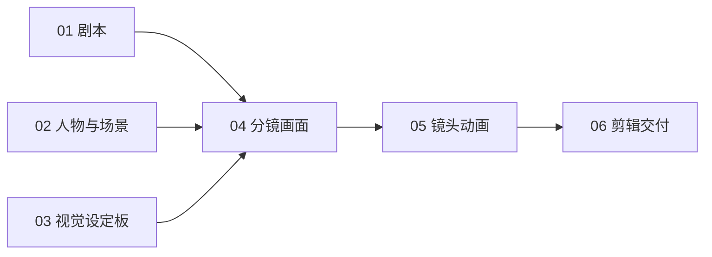

# 最后一单：六节点制作流程

这一版只有一条制作路径。剧本、人物场景设定和参考图汇入“分镜画面”；画面确认后进入对应的“镜头动画”；视频确认后进入剪辑时间线。



## 只做这三步

1. **04 分镜画面**：选择镜头 → 生成图片 → 选定满意的结果 → 勾选“确认此画面”。生成会实际读取左侧连接的剧本、人物设定和视觉参考板。每镜预填的是静态构图提示词。
2. **05 镜头动画**：打开同号镜头，首帧自动取自04中确认的图片，不必再选图。生成视频 → 预览 → 勾选“选为输出”。每镜预填动作和运镜提示词。上游未确认或连线断开时，视频生成不可执行。
3. **06 剪辑交付**：点击“添加已连接视频”，读取05中所有已确认视频，调整排列和入出点 → “合并到画布” → 下载。重复点击不会重复加入同一镜，已有手工排序、裁切保留；后续补做的镜头会追加，按需要调整到正确位置。

## 六个节点分别做什么

| 节点 | 输入 | 产出 | 下一步如何拿到 |
|---|---|---|---|
| 01 剧本 | 已填写的原创卡通剧本 | 镜头剧情、对白、声音说明 | 连线传给04作为生成上下文 |
| 02 人物与场景 | 猫店员、兔顾客、便利店规范 | 统一角色和场景约束 | 连线传给04 |
| 03 视觉设定板 | 已实际绘制的卡通参考图 | 视觉参考 | 连线传给04的图片请求 |
| 04 分镜画面 | 01–03及各镜构图提示词 | 12镜的图片候选 | 确认的选中图片按镜头身份绑定到05 |
| 05 镜头动画 | 04对应镜头的确认图片、运镜提示词 | 12镜的短视频 | “选为输出”后供06读取 |
| 06 剪辑交付 | 05确认输出的视频 | 顺序拼接、裁切后的画面文件 | 下载后配音、字幕与混音 |

04只负责图片，05只负责视频，这两个节点在此模板中固定阶段，避免误切模式混淆结果。其他普通分镜节点仍可切换模式。

## 已有素材与验证样片

使用二维猫店员、兔顾客的卡通方案，12镜×5秒，目标60秒。包内已经放入第一镜真实卡通首帧和此前成功生成的5秒视频，作为跑通整条链路的样例。两张输入图来自Codex imagegen；视频来自Seedance 2.5任务1afd64f7-6594-46a7-8280-195d3dbbe953。其余11镜没有伪造结果。

初始时间线为空，导入后直接做第3步即可验证第一镜进入剪辑。无需再次提交第一镜付费生成。

## 使用边界

- 这是分阶段确认的制作流程，连线不会自动触发付费生成。
- 剧本与每镜构图是创作上下文；修改剧情后，应同步调整受影响镜头的提示词。不会自动重写全部分镜。
- 图片与视频通过稳定镜头身份绑定，不依赖镜头名称或当前排序。新插入的视频镜头需要声明对应图片镜头；本模板的12镜已配好。
- 修改上游确认图片后，05会读取新首帧；已经生成的视频仍保留，需决定是否重新生成，并核对输出选择。时间线已有剪辑不会被上游重生成静默覆盖。
- 动画节点中的首帧为关联输入，不能在此处改成另一张独立素材；去04修改对应画面即可。
- 本次交付包含画面生产和画面合片；对白配音、声音设计、字幕和小票叠字在后期完成。相关台词和声音入点都在01剧本中。

## 文件与重建

- `最后一单-清晰制作流程.zip`：导入包，6节点、5连线、3个媒体文件。
- `project.json`：可检查的节点与连线数据。
- `build.py`：由已有卡通创作稿重建此精简流程，不会调用模型。

```sh
python3 examples/clear-cartoon-workflow/build.py
npx vitest run tests/clear-storyboard-flow.test.js tests/last-order-workflow.test.js tests/storyboard-cards.test.jsx --maxWorkers=1 --minWorkers=1
```

## 本轮验收

已在系统Chrome导入独立项目“最后一单｜六节点制作流程”，并验证：

- 取消04第一镜的“确认此画面”，05对应镜头显示等待确认，生成按钮禁用；恢复确认后，自动读到同一张首帧并恢复生成。
- 06从05读入第一镜，入点0秒、出点5秒；再次添加未产生重复片段。
- 导入媒体的本地素材标识已在播放和上传合片前解析，保存仍保留原素材身份。
- 本地实际合片成功，生成可下载视频并回填画布。复用已有卡通第一镜，没有再提交付费模型请求。
- 本轮针对性测试8项通过；完整60秒成片仍需完成其余11镜及后期声音字幕。
